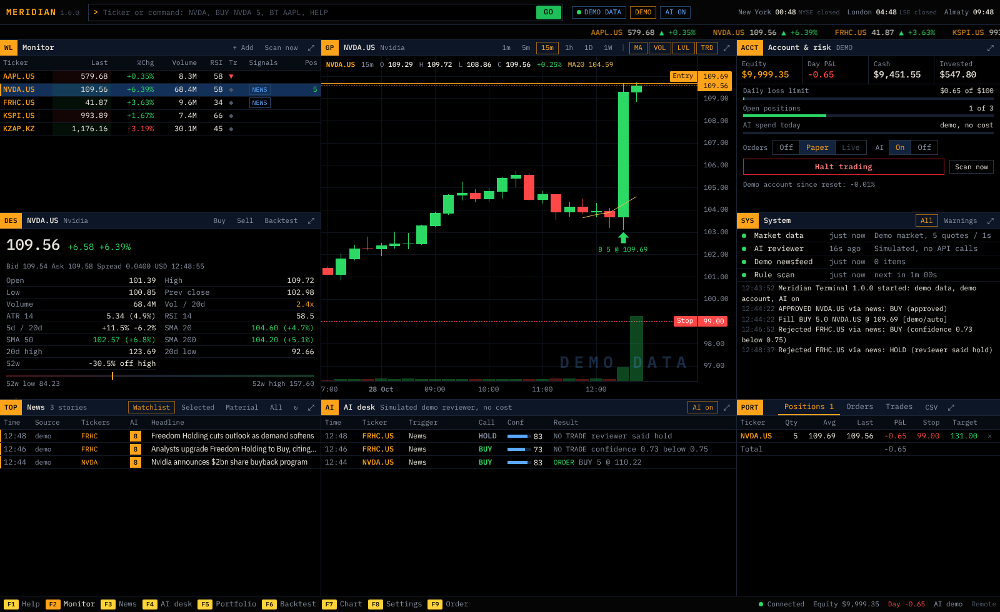

# Meridian Terminal

A Bloomberg-style trading terminal for **Freedom Broker (Tradernet)** with Claude in the loop.
Simple rules and fresh news propose trades, Claude reviews each idea against the chart, the
headlines and your position, and a hard-coded risk gate makes the final call.



| Platform | What you get | Install |
|---|---|---|
| macOS 14+ (Apple Silicon or Intel) | `Meridian Terminal.app` in a DMG | Drag to Applications |
| Windows 10/11 (64-bit) | `MeridianTerminal-Setup-1.0.0.exe` | Run the installer |
| Fedora (and other systemd Linux) | `meridian-terminal-1.0.0-1.x86_64.rpm`, or a tarball | `sudo dnf install ./meridian-terminal-*.rpm` |

The desktop apps open in their own window. The Fedora build runs headless as a systemd service
and serves the same dashboard over HTTP, so you can open it from your laptop through an SSH
tunnel.

---

## Getting the installers

Nothing here is pre-built: you build each installer once, either on GitHub or on your own machines.

### Option A: let GitHub build all of them (recommended)

1. Create a private GitHub repository and push this folder to it.
2. Open **Actions → Build installers → Run workflow**. In about 15 minutes you get:
   - two macOS DMGs (Apple Silicon and Intel),
   - the Windows installer,
   - the Fedora RPM and a Linux tarball.
3. Each job runs the tests and starts the built app once to check it answers.
4. Download the files from the run's **Artifacts**.
5. To publish a release instead, push a tag (`git tag v1.0.0 && git push --tags`). The files then attach to a GitHub Release.

### Option B: build on your own machine

| On | Run | Result in `dist/` |
|---|---|---|
| macOS | `bash packaging/macos/build.sh` | `MeridianTerminal-1.0.0-macOS-arm64.dmg` |
| Windows | `powershell -ExecutionPolicy Bypass -File packaging\windows\build.ps1` | `MeridianTerminal-Setup-1.0.0.exe` |
| Linux | `bash packaging/linux/build.sh` | `.rpm` and `.tar.gz` |

What each build needs:
- **All:** Python 3.11 or newer.
- **Windows:** Inno Setup 6 as well (`winget install JRSoftware.InnoSetup`).
- **Linux RPM:** `rpm-build` as well.

Each script creates its own virtual environment, runs the tests, freezes the app with PyInstaller, smoke-tests it, and packages it.

---

## Installing

### macOS
1. Open the DMG and drag **Meridian Terminal** to Applications.
2. If you built the app yourself on this Mac, it opens normally.
3. If you downloaded it from GitHub, the build is unsigned, so macOS blocks the first launch. To allow it:
   - right-click the app and choose **Open**, or
   - go to **System Settings → Privacy & Security → Open Anyway**, or
   - run `xattr -dr com.apple.quarantine "/Applications/Meridian Terminal.app"`.

For a signed and notarized build, add an Apple Developer certificate as GitHub secrets (see `.github/workflows/build.yml`).

API keys are stored in the macOS Keychain. After an app update, macOS may ask once to let the new build read them; choose **Always Allow**.

### Windows
1. Run the installer. Because it's unsigned, SmartScreen may warn you: choose **More info → Run anyway**.
2. It installs per user, with no admin rights needed, and adds a Start-menu entry.
3. The window uses Microsoft Edge WebView2, which is built into Windows 10 and 11. If it's missing, the app opens in your browser instead.

API keys go to Windows Credential Manager. A console `meridian.exe` is installed next to the app for command-line use.

### Fedora (headless)
```bash
sudo dnf install ./meridian-terminal-1.0.0-1.x86_64.rpm
sudo meridian setup                    # API keys, data source, watchlist, risk limits
sudo systemctl enable --now meridian   # start now and at boot
sudo meridian url                      # prints the dashboard link with its access token
```
To open the dashboard from your laptop:
1. Start an SSH tunnel: `ssh -L 8765:127.0.0.1:8765 you@server`.
2. Open the link printed by `sudo meridian url`.

The service listens on localhost only by default. Don't expose it directly: it serves plain HTTP. If you need remote access without SSH, use a VPN such as Tailscale.

Useful commands:
- `sudo meridian status`: account, feeds and positions.
- `sudo meridian halt` and `sudo meridian resume`: the kill switch.
- `sudo meridian backtest NVDA.US --years 5`: backtest from the command line.
- `journalctl -u meridian -f`: live logs.

Settings, keys (in a `0600` file) and the trade database live in `/var/lib/meridian`. Other distros: unpack the tarball and run `sudo ./install.sh`.

---

## First launch

A welcome dialog offers two paths:

- **Explore with demo data.** Simulated prices, headlines and a simulated reviewer. No keys are needed, nothing real happens, and the whole interface works.
- **Connect Freedom Broker and Claude.** Paste your Anthropic API key (console.anthropic.com) and your Tradernet key pair (Tradernet → profile → API keys), test each, and switch to live data. Orders still go to the **paper** account.

Real-money trading only starts when you pick **Live** in the Account panel and type `LIVE` to confirm.

## Using the terminal

Type anywhere to reach the command line. A few commands:

| Command | Does |
|---|---|
| `NVDA` | Show a ticker |
| `BUY NVDA 5 @ 182.40` | Open the order ticket |
| `BT NVDA AAPL` | Backtest the rules |
| `TF 15m` | Chart timeframe |
| `HALT` / `RESUME` | Kill switch |
| `MODE PAPER` | Where orders go |
| `HELP` | Everything else |

Function keys: **F1** help, **F2** monitor, **F3** news, **F4** AI desk, **F5** portfolio, **F6** backtest, **F7** chart, **F8** settings, **F9** order ticket. Double-click any panel's title bar to make it full screen.

| Panel | Shows |
|---|---|
| **WL Monitor** | Live quotes, day range, RSI, trend, which rules are firing, holdings |
| **GP Chart** | Candles 1m–1W, volume, MA 20/50/200, your fills, entry/stop/target lines |
| **DES Security** | Key stats, 52-week range, how close each rule is to firing, a risk-sized trade plan, recent verdicts and headlines |
| **TOP News** | Every headline with Claude's 0–10 materiality score |
| **AI desk** | Every idea, Claude's call and confidence, what the risk gate did; click a row for the full reasoning |
| **PORT Portfolio** | Positions with live P&L, orders, fills, CSV export |
| **ACCT Account & risk** | Equity, day P&L against the loss limit, AI spend against budget, execution mode, kill switch |
| **SYS System** | Health of every feed and the live log |

## How a trade happens

1. **Rules propose.** A rule fires on the price scan (trend breakout, oversold bounce, volume surge, and trend/overbought exits), or a fresh watchlist headline scores high enough with the cheap triage model.
2. **Claude reviews.** The review model (Opus 5.5 by default, Fable 5.1 optional) sees the technicals, 48 hours of headlines and your position. It can confirm the proposed direction or say hold, never flip it. Headlines are passed as untrusted data.
3. **The risk gate decides.** In plain code it checks:
   - confidence and the watchlist,
   - that the story mentions the ticker,
   - max open positions, the daily loss limit, the per-ticker cooldown, and the kill switch.

   It then sizes the order so hitting the ATR stop loses about your *risk per trade*.
4. **The order goes out.** It's a day limit order, never on margin and never short. Stop and target are attached after the fill: at the broker in live mode, simulated in paper mode.

Claude spend is tracked per call and stops for the day at your budget (Settings → AI). The token prices used for that estimate are editable; check them against anthropic.com/pricing.

## Before you trade real money

- **Backtest first (F6).** Keep only the rules that beat buy-and-hold after costs on several tickers. Claude can't be backtested honestly, because it has read about past prices, so judge it by weeks of paper trading.
- **Check ticker codes** with the add-ticker search (for example, Kazatomprom's exact Tradernet code).
- **Check Tradernet's responses.** They are parsed defensively in `meridian/engine/tradernet_api.py`. On first live use, confirm that quotes, positions, orders and news look right. Also check in the Tradernet terminal that stops and targets appear on your positions.
- **Keep the app open, or use the headless service.** The desktop app trades only while it's open; the service runs around the clock. Broker-side stops stay active either way.
- This is a personal tool, not financial advice. You are responsible for every order it sends.

## Files

| | macOS | Windows | Linux service |
|---|---|---|---|
| Data folder | `~/Library/Application Support/Meridian Terminal` | `%LOCALAPPDATA%\Meridian Terminal` | `/var/lib/meridian` |
| API keys | Keychain | Credential Manager | `secrets.json` (0600) |

The data folder holds `settings.json`, `meridian.sqlite` (news, decisions, orders, trades, AI usage) and `logs/`. Creating a file named `STOP` in it halts trading even if the UI is unreachable.

## Development

```bash
python3 -m venv .venv && . .venv/bin/activate
pip install -r requirements-desktop.txt pytest
python -m meridian gui          # desktop window (or: python -m meridian headless)
python -m pytest -q             # 24 tests, including a live-mode run against a fake Tradernet
```

| Path | Contents |
|---|---|
| `meridian/engine/` | Strategies, risk gate, Claude analyst, Tradernet layer, paper broker, demo market, backtester |
| `meridian/server.py` | Local REST and WebSocket API, token-protected |
| `meridian/web/` | The terminal UI: vanilla JS, no build step |
| `packaging/` | PyInstaller spec, platform build scripts, installer definitions, the systemd unit |

To rename the app, change `APP_NAME` in `meridian/__init__.py` and the names in `packaging/`.
